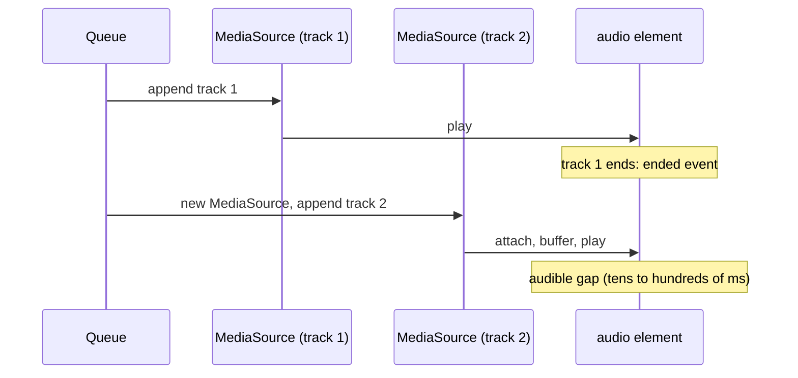
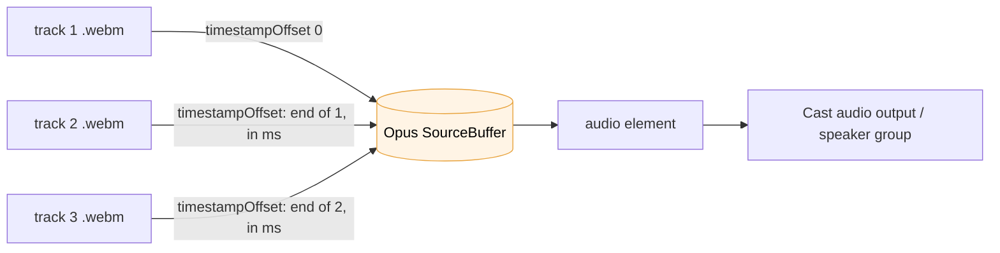
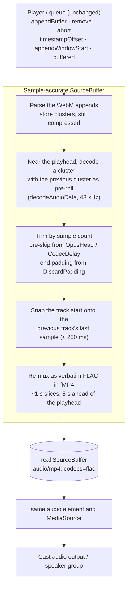
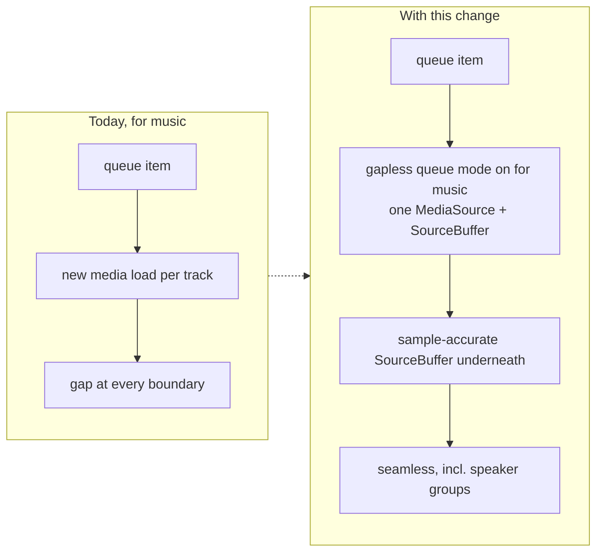

# Gapless Opus on Google Cast, through MSE

This is a small demo of sample-accurate gapless playback of per-track Opus/WebM files on Google Cast devices. The decoding and joining are done entirely on the receiver, with no server-side processing. It includes a public-domain test album: one complete orchestral movement cut into 14 tracks at arbitrary points mid-sound.

The point is to show the change a music Cast receiver needs, in code small enough to read in one sitting:

- Use **one MediaSource and one SourceBuffer for the whole queue**, which is a gapless queue mode many players already have.
- Put a **sample-accurate SourceBuffer** underneath it. This is a drop-in object that decodes the Opus, trims encoder delay and padding by sample count, and hands MSE lossless PCM (FLAC in fMP4).

The player code above the SourceBuffer doesn't change: one flag switches it. For comparison there is also a **per-track (stock)** mode, which loads every track into its own MediaSource the usual non-gapless way. You can switch between all three modes while the album plays, and it carries on from the same spot.

> Not affiliated with Google or YouTube. This repository contains no code from any Google receiver. Everything here is original and MIT-licensed, and the audio is public domain.

## Results

**Desktop Chrome (headless, measured).** Each join was played from 4 s before the cut. The output was aligned with the original continuous recording on both sides of the join. For the queue modes, the table shows how far the playback timeline moved across the cut, and 0 means seamless. For per-track loading it shows the silence inserted at the boundary.

| Join | Per-track (stock) | Plain MSE queue | Sample-accurate SourceBuffer |
|---|---|---|---|
| 1 → 2 | 29 ms of silence | −168 samples (3.5 ms lost) | **0** |
| 4 → 5 | 18 ms of silence | −130 samples (2.7 ms) | **0** |
| 9 → 10 | 19 ms of silence | −7 samples (0.15 ms) | **0** |
| 10 → 11 (inside the crescendo) | 79 ms of silence | −187 samples (3.9 ms) | **0** |
| 13 → 14 | 19 ms of silence | −8 samples (0.17 ms) | **0** |

On a Cast device the per-track gap is much longer, because each new media load goes through the device's slower pipeline.

**Chromecast Audio** (2015 model, Cast firmware 1.56, Chrome 90, 512 MB RAM):

- Plain MSE with Opus clicks audibly at every track boundary, even when the timestamps are right. The device's media pipeline does not splice Opus across appends cleanly.
- With the sample-accurate SourceBuffer the album plays seamlessly. This includes a **speaker group** of two Chromecast Audios, and **adding a speaker to the stream while it plays**.
- The same SourceBuffer wrapper was also tested underneath the gapless queue mode of a production streaming player engine, running unchanged above it. This album played gaplessly there too.

**Google TV (onn 4K, 2023):** not tested yet.

## How it works

### Today: one media load per track

A typical music receiver loads each track into its own media pipeline. At every boundary the old stream ends and the new one starts, and you hear the gap.



### Step 1: one SourceBuffer for the whole queue

The usual gapless queue mode appends track after track into the same SourceBuffer. Each track is placed with `timestampOffset` at the previous track's end, with `appendWindowStart` at the same point. This removes the reload, but not the last few milliseconds. Opus files start with encoder delay (pre-skip, 312 samples here) and end with padding (`DiscardPadding`). Millisecond-rounded offsets can't line up 48 kHz samples, and on the Chromecast the media pipeline clicks at each splice anyway. `public/js/mse-queue.js` is this mode, written as plainly as possible.



### Step 2: swap only the SourceBuffer

`public/js/sample-accurate-sb.js` hooks `MediaSource.prototype.addSourceBuffer`. When the player asks for an Opus SourceBuffer, it gets back an object with the same API. Behind that object, a real `audio/mp4; codecs="flac"` SourceBuffer in the same MediaSource carries the audio.



The details that matter in practice:

- **`buffered` is reported in the player's own coordinates**, where it placed each append before trimming and snapping. A player that compares `buffered` with its own bookkeeping, as gapless queue code does, keeps working unchanged.
- **The MSE quota on a Chromecast Audio is about 2 MB**, roughly 10 s of 16-bit stereo PCM. Audio therefore goes to the real buffer in ~1 s slices, about 5 s ahead, and is evicted 1.5 s behind. The compressed Opus waits in JS memory.
- **`endOfStream()` is deferred** until the last decoded audio has been handed over.
- **It stays media-element audio**, so Cast speaker groups and stream expansion work as usual. Web Audio output is not forwarded to groups.
- **Cost:** one `decodeAudioData` per ~10 s cluster, plus copying PCM into verbatim FLAC frames, with no compression step. A 2015 Chromecast Audio keeps up comfortably.

### What a music receiver would change



1. Request the player's gapless queue mode for music queues too. You could do it only for albums whose tracks flow into each other, or for everything, because a correct join is harmless between unrelated songs.
2. Install the sample-accurate SourceBuffer (or the same logic inside the player's own buffer layer) for Opus.

No new hardware, no server changes, and the same per-track files.

## Run it

Requirements: Node.js 18 or newer. There are no npm dependencies.

```
node server.js          (or double-click start.bat on Windows)
```

**In this browser:** open `http://localhost:8080/`, pick a mode and press **Play album**. You can also choose a join, such as *10 → 11*, and press **Go** to start 4 s before it. Change the mode while it plays: the receiver restarts at the same position in the new mode, with no reload or reconnect.

**On a Cast device:**

1. In the [Google Cast SDK Developer Console](https://cast.google.com/publish), add a *Custom Receiver* with the URL the server prints, `http://<this computer's LAN IP>:8080/receiver.html`. Register your Cast device's serial number for development, and reboot the device once. While the app is unpublished, a registered device loads it over plain HTTP.
2. Open `http://localhost:8080/` on the same computer. The Cast sender API needs a secure context, and `localhost` counts as one. Enter the app ID and press **Cast…** to pick the device.
3. Select **Cast device** and play. The receiver shows the current track and mode on screen, and logs come back to the page.

**As a public online demo:** everything is static, so any HTTPS static host works. GitHub Pages is the simplest: choose *Settings → Pages → Source: GitHub Actions*, and the included workflow (`.github/workflows/pages.yml`) publishes `public/` on every push to `main`. Set the Cast console app's receiver URL to `https://<user>.github.io/<repo>/receiver.html` and publish the app. Published apps run on any Cast device without serial registration, but they must be served over HTTPS. Visitors then open the Pages URL in desktop Chrome or Edge, press **Cast…**, and play. Put the published app ID into `DEFAULT_APP_ID` in `public/index.html`, so visitors don't have to type it.

## Files

| Path | What it is |
|---|---|
| `public/js/sample-accurate-sb.js` | The sample-accurate SourceBuffer (the interesting part) |
| `public/js/mse-queue.js` | A deliberately ordinary single-SourceBuffer queue player |
| `public/js/flac-mp4.js` | WebM/EBML reading, Opus packet sizes, FLAC frame + fragmented MP4 writer |
| `public/js/demo.js` | Shared glue for the page and the receiver |
| `public/index.html` | Local player and Cast sender |
| `public/receiver.html` | Cast receiver (CAF, custom message namespace, its own `<audio>`) |
| `public/album/` | 14 Opus/WebM tracks, `album.json`, `SOURCE.txt` |
| `server.js` | Zero-dependency static server with byte ranges |

## The test album

The album is Beethoven's Symphony No. 5 in C minor, Op. 67, fourth movement (Allegro), performed by the Skidmore College Orchestra and released into the public domain by [Musopen](https://musopen.org/). It comes from [Wikimedia Commons](https://commons.wikimedia.org/wiki/File:Ludwig_van_Beethoven_-_symphony_no._5_in_c_minor,_op._67_-_iv._allegro.ogg).

The whole movement (706.7 s) is cut into 14 tracks of 9 s to 202 s, at uneven sample positions in sounding music. Track 10 starts inside the crescendo into the recapitulation. Each track was encoded separately, the way music services encode per-track Opus: 160 kb/s VBR, 20 ms frames, 48 kHz. Each file was then remuxed into the usual streaming layout, with Cues before the first Cluster and timestamps from 0. Every file decodes to exactly its cut length. Cut positions and commands are in [`public/album/SOURCE.txt`](public/album/SOURCE.txt).

## Licence

The code is under the MIT licence (see [LICENSE](LICENSE)). The recording and composition are in the public domain. Musopen asks, as a courtesy, that the recordings not be sold directly and that Musopen be credited.
